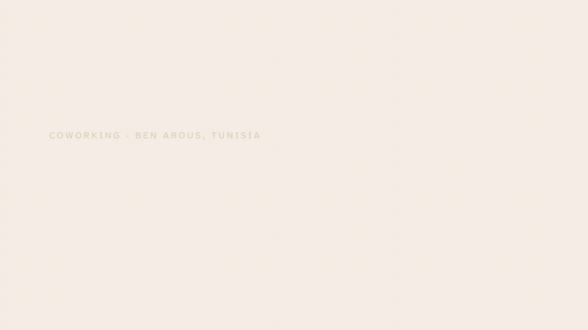
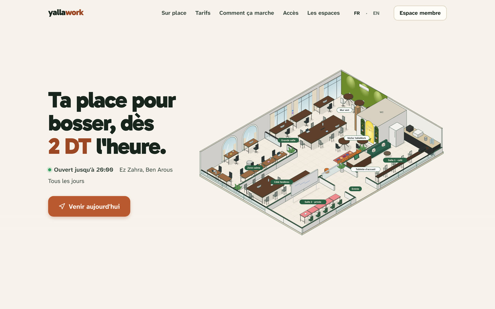
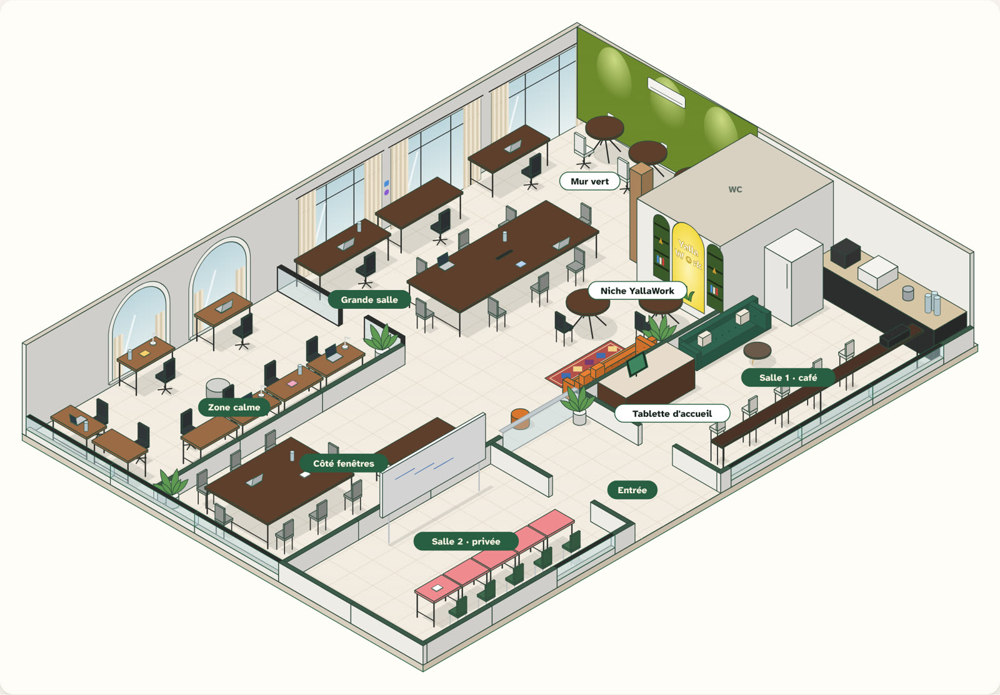
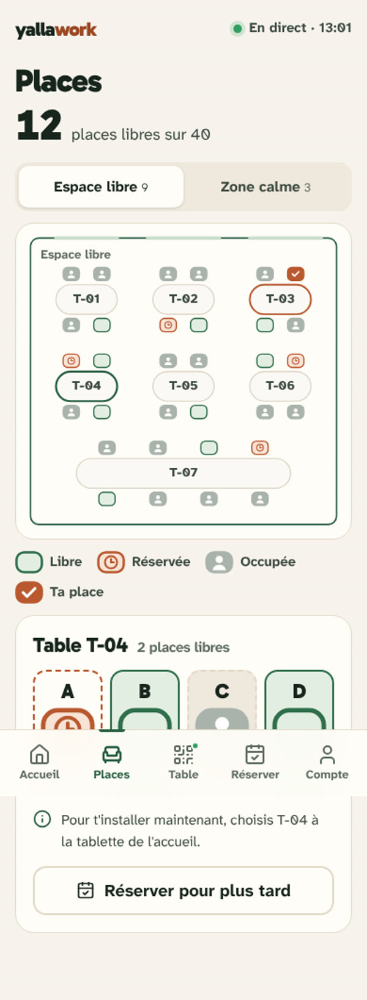

# YallaWork

**One app that runs a whole coworking space in Ben Arous, Tunisia.** It includes a public website, a member app with a live seat map, a QR code on every desk, a reception tablet, and an admin panel.

▶ [Watch the video (MP4)](media/brag.mp4) · 🌐 [Live demo](https://yallawork-test.vercel.app)

| Website | Live seat map | Member app |
|---|---|---|
|  |  |  |

**What it does**
- Members see which places are free right now and check in by scanning the QR code on their desk
- The reception tablet handles sign-ups, payments and snacks
- The admin panel covers today's clients, money reports, packs and subscriptions, and a floor-plan editor

**Built with** Next.js · React · TypeScript · PostgreSQL · PWA

---

The source code is private. © 2026 Koussay Ben Salem. All rights reserved: see [LICENSE](LICENSE).
